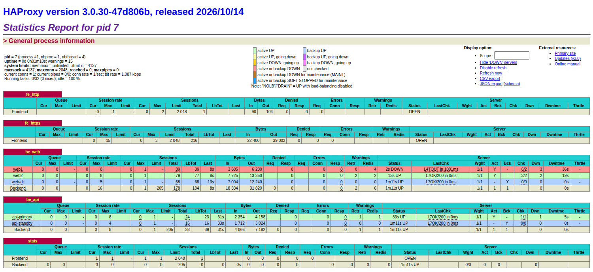

# Secure Proxy Failover Lab


I wanted to see what really happens to traffic when a server goes down, so I built a small lab to try it. It's one HAProxy proxy in front of five servers, all running in Docker. You kill servers and watch where the requests go.

It covers traffic routing, failover, and keeping things up when parts of the network break.

## Demo

This is the output of `make demo`, recorded from a run in GitHub Actions. Each line is one request and the name of the server that answered it.


A few things you can see in there:

- At the start, `web1` and `web2` take turns.
- I stop `web1`. The next two requests take about a second instead of 3ms, but they still work. That second is the proxy giving up on `web1` and retrying on `web2`.
- I stop `web2` as well. Now there's nothing left in the main pool, so the backup server `web-dr` picks up.
- I start both again and a few seconds later traffic is back on `web1` and `web2`.

Nothing failed. Every request got a 200.

HAProxy also has a stats page. This is what it looks like with `web1` down (the red row):



If you want to see the full test output, it's in the [Actions tab](https://github.com/ZakariDev27/secure-proxy-failover-lab/actions/workflows/ci.yml). Open any run and look at the "Run failover test" step.

## How it's laid out


There are two groups of servers behind the proxy.

The web group has `web1` and `web2` sharing the load, and `web-dr` as a spare that only gets used if both of them are down.

The API group is just a primary and a standby. Anything starting with `/api` goes there.

The servers are on their own Docker network with no ports exposed, so the only way to reach them is through the proxy.

## Running it

You need Docker, `make`, `openssl` and `curl`.

```bash
git clone https://github.com/ZakariDev27/secure-proxy-failover-lab.git
cd secure-proxy-failover-lab

make up      # makes a cert and starts everything
make demo    # the walkthrough from the recording above
make test    # runs the checks
make down    # stops everything
```

Once it's up you can hit it yourself:

```bash
curl -k https://localhost:8443/
# {"node":"web1","pool":"web","role":"active","path":"/"}
```

The `-k` is because the cert is self-signed. Your browser will complain about it too. That's fine for a lab.

Stats page is at http://localhost:8404/stats.

If you'd rather break things by hand, run `make watch` in one terminal and use these in another:

```bash
make kill NODE=web1
make kill NODE=web2
make revive NODE=web1
make revive NODE=web2
```

## The test

`make test` goes through the same kind of failures as the demo, but it actually checks the results and fails if something's off. It runs on every push. Roughly:

1. Normal traffic gets split between `web1` and `web2`, and `/api` goes to `api-primary`.
2. HTTP redirects to HTTPS, the security headers are there, old TLS is refused.
3. Kill one web server. No requests should fail.
4. Kill the other one. The backup should take over.
5. Bring them back. Traffic should move back.
6. Same idea for the API: kill the primary, standby takes over, then hand back.

On the first run, failover and failback each took around 4 to 5 seconds and no requests were dropped.

I'll be upfront about step 4 though. When a whole pool dies at once, there's a short gap before the proxy notices and switches to the backup, and a request can fail in that gap. It didn't happen in my runs, but it can. The test counts those and prints the number instead of pretending it's always zero.

## How the failover works

It's all in [`haproxy/haproxy.cfg`](haproxy/haproxy.cfg). I commented the file pretty heavily, but these are the lines that matter.

Health checks. The proxy pings every server every 2 seconds. Miss two and you're out, pass two and you're back in:

```haproxy
default-server check inter 2s fall 2 rise 2 ...
```

It also watches real traffic, so if two real connections fail in a row it pulls the server right away without waiting for the next check:

```haproxy
... observe layer4 error-limit 2 on-error mark-down
```

Retries. If a connection fails, try a different server instead of sending the user an error. This is where that 1 second delay in the demo comes from:

```haproxy
retries 2
option redispatch 1
timeout connect 1s
```

And `backup` means "don't use this unless everything else in the group is down":

```haproxy
server web1   web1:80
server web2   web2:80
server web-dr web-dr:80 backup
```

## Security stuff

The main point was failover, but I didn't want to do it on a wide open setup, so:

- HTTPS only, TLS 1.2 and up. HTTP just redirects.
- Security headers on responses, and the `Server` header is removed so it doesn't give away what's running.
- Rate limit of 200 requests per 10 seconds per client.
- Backend servers aren't reachable from outside the proxy.
- HAProxy runs as non-root with Linux capabilities dropped.
- The stats page only listens on localhost.

## Files

```
docker-compose.yml          the whole setup
haproxy/haproxy.cfg         routing, health checks, failover, TLS
backends/                   nginx config the servers share
scripts/gen-certs.sh        makes the self-signed cert
scripts/demo.sh             the walkthrough
scripts/failover-test.sh    the test
scripts/watch.sh            live view of who's answering
.github/workflows/ci.yml    runs the test on every push
```

## What's missing

The big one: the proxy is a single point of failure. If HAProxy dies, everything's down, which is a bit ironic for a failover lab. The fix is two proxies sharing a virtual IP with keepalived. That's what I want to do next.

Also the cert is self-signed, and the servers don't store anything, so I'm skipping the hard part of failover, which is what happens to sessions and data.

Other things I might add: Prometheus/Grafana, making servers slow instead of just dead, and TLS between the proxy and the servers.
