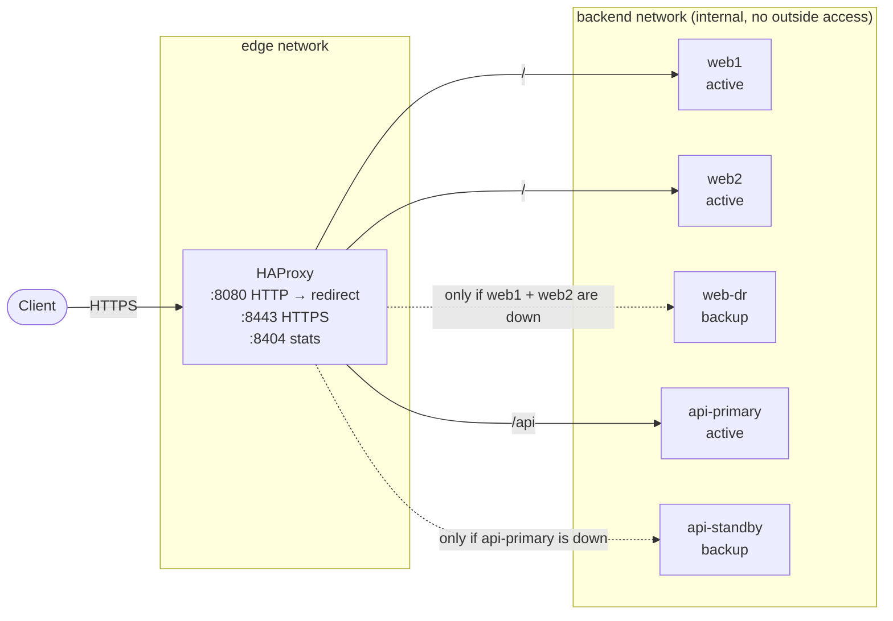

# Secure Proxy Failover Lab


What actually happens to your traffic when a server dies?

I built this lab to answer that question hands-on. It's a small network you can run on your laptop: one secure proxy out front, five servers behind it, and a script that knocks servers over on purpose to see whether anyone on the outside would notice.

It covers three things I wanted to understand properly:

- **Traffic routing:** how a proxy decides which server gets each request
- **Failover:** how traffic moves when a server goes down, and how it moves back
- **Network resilience:** how to keep users from ever seeing the failure

## The setup



HAProxy sits at the edge and is the only way in. Behind it are two groups of servers:

- **The web pool** has two servers sharing the load, plus a third that sits idle until both of the others are gone.
- **The API pool** is a simple primary and standby. The standby only steps in when the primary is down.

The backend servers live on a private Docker network with no ports open to your machine, so you can't reach them except through the proxy.

## Run it

You'll need Docker (with Compose), `make`, `openssl` and `curl`.

```bash
git clone https://github.com/ZakariDev27/secure-proxy-failover-lab.git
cd secure-proxy-failover-lab

make up      # creates a certificate and starts everything
make test    # breaks things and checks the results
make down    # shuts it all down
```

Then try it:

```bash
curl -k https://localhost:8443/
# {"node":"web1","pool":"web","role":"active","path":"/"}
```

Every server answers with its own name, so you always know who handled your request. Run that command a few times and you'll see it alternate between `web1` and `web2`.

The certificate is self-signed, which is why `curl` needs `-k` and your browser will show a warning. That's expected for a lab.

There's also a live dashboard at <http://localhost:8404/stats> that shows every server and whether the proxy thinks it's up or down.

## Break it yourself

This is the fun part. Open two terminals.

In the first one, watch where requests are going:

```bash
make watch
```

In the second one, start taking servers down:

```bash
make kill NODE=web1      # web2 quietly picks up everything
make kill NODE=web2      # now the backup, web-dr, takes over
make revive NODE=web1    # traffic moves back on its own
make revive NODE=web2
```

Keep an eye on the first terminal while you do it. You'll see the server names change, but the requests keep succeeding.

## What the test proves

`make test` runs through six scenarios and fails if any of them go wrong. It also runs automatically on every push to this repo. Here's what it showed on the first run:

| Scenario | Result |
|---|---|
| Normal operation | Requests split evenly between `web1` and `web2`. The backup stayed idle. `/api` requests all went to `api-primary`. |
| Security checks | HTTP redirected to HTTPS, security headers present, old TLS versions refused. |
| One web server dies | 30 out of 30 requests still succeeded. |
| Both web servers die | The backup took over. 0 out of 40 requests lost. |
| Web servers come back | Traffic returned to them in about 4 seconds. |
| API primary dies, then returns | Standby took over in about 4 seconds, and handed back in about 5. |

One thing worth knowing: losing one server out of several is easy to hide, because the proxy just retries on another one. Losing an entire pool is harder. There's a short moment before the proxy realises everything is down and switches to the backup, and requests can fail in that window. The test counts those failures and reports them rather than hiding them. On the run above it happened to be zero, but it won't always be.

## How it works

Everything interesting is in [`haproxy/haproxy.cfg`](haproxy/haproxy.cfg), and the file is commented throughout. The short version:

**The proxy keeps checking on every server.** Every two seconds it asks each one "are you okay?" Two missed answers and the server is taken out of rotation. Two good answers and it's back in.

```haproxy
default-server check inter 2s fall 2 rise 2 ...
```

**It also learns from real traffic.** If two real requests in a row fail to connect, the proxy doesn't wait for the next check. It pulls that server immediately.

```haproxy
... observe layer4 error-limit 2 on-error mark-down
```

**Failed requests get a second chance somewhere else.** Instead of passing an error back to the user, the proxy tries a different server. This is why nobody notices when a single server dies.

```haproxy
retries 2
option redispatch 1
```

**Backups wait their turn.** A server marked `backup` gets nothing until every regular server in its pool is down.

```haproxy
server web1   web1:80
server web2   web2:80
server web-dr web-dr:80 backup
```

## The "secure" part

Failover was the main goal, but I didn't want to build it on an insecure base. So the lab also has:

- **Encryption at the edge.** All traffic uses HTTPS with TLS 1.2 or newer. Plain HTTP gets redirected.
- **Security headers** on every response, and the backend's `Server` header stripped so it doesn't advertise what software is running.
- **Rate limiting.** Any client sending more than 200 requests in 10 seconds starts getting refused.
- **Isolated backends.** The servers can't be reached from outside, and can't reach out either.
- **A locked-down proxy.** It runs as a non-root user with all Linux capabilities dropped.
- **A private dashboard.** The stats page only listens on localhost.

## What's in the repo

```
.
├── docker-compose.yml          # the whole network in one file
├── haproxy/haproxy.cfg         # routing, health checks, failover, TLS
├── backends/                   # the config every backend server uses
├── scripts/
│   ├── gen-certs.sh            # makes the self-signed certificate
│   ├── failover-test.sh        # the automated break-it-and-check test
│   └── watch.sh                # live view of who's answering
├── .github/workflows/ci.yml    # runs the test on every push
└── Makefile                    # shortcuts for all of the above
```

## What I'd add next

This is a learning lab, and it has some honest gaps:

- **The proxy itself is a single point of failure.** If HAProxy goes down, everything goes down. The fix is a second proxy with a shared virtual IP (keepalived/VRRP), and that's the next thing I want to build.
- **The certificate is self-signed.** Fine for localhost, not for anything real.
- **The servers don't hold any data.** Failing over is much harder when there are sessions or a database involved.

Other ideas on the list: Prometheus and Grafana for monitoring, simulating slow servers instead of dead ones, and encrypting the traffic between the proxy and the backends too.
