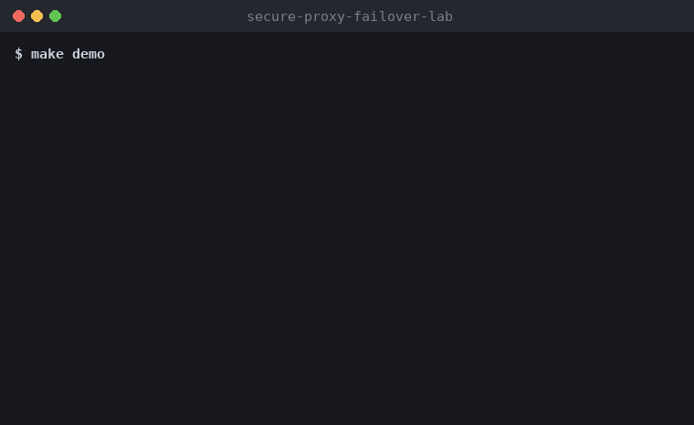
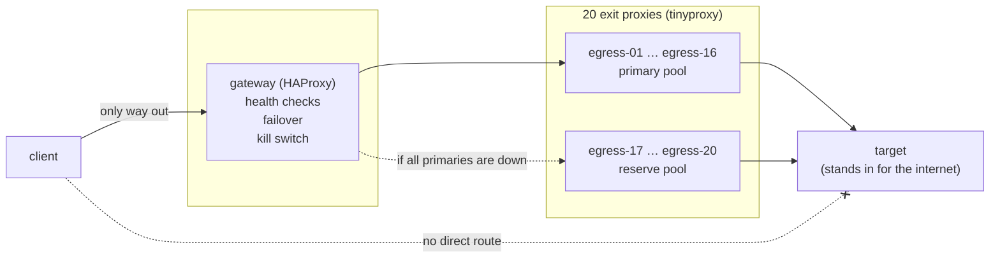

# Secure Proxy Failover Lab


A lab for outbound traffic. A client sends everything through a gateway, and the gateway spreads it across 20 exit proxies. I wanted to see three things:

- what happens when exit proxies die (failover)
- what happens when all of them die (kill switch)
- whether anything can sneak out around the proxies (it shouldn't)

Everything runs in Docker on one machine.

## Demo

This is `make demo`, recorded from a run in GitHub Actions. Each line is one request from the client and the exit proxy it went out through.



What's happening in there:

1. Normal traffic rotates through the 16 primary proxies.
2. I crash one proxy. One request takes a second longer because the gateway had to retry it somewhere else, but nothing fails.
3. I crash all 16 primaries. One request gets dropped while the gateway works out they're gone, then the 4 reserve proxies take over.
4. I crash the reserves too. Now there's no way out, so everything is `BLOCKED`. This is the kill switch doing its job.
5. I bring all 20 back and traffic picks up again within a second or so.
6. I flip the manual kill switch. Everything is blocked instantly even though all 20 proxies are healthy. Flip it off and traffic comes back.

The stats page with three proxies down (red rows). Green is the primary pool, blue is the reserve pool:


Full test output is in the [Actions tab](https://github.com/ZakariDev27/secure-proxy-failover-lab/actions/workflows/ci.yml), under "Run failover and kill switch test".

## How it's laid out



- **client** is the machine whose traffic I care about. It's on a network with no route out. The gateway is the only thing it can talk to.
- **gateway** is HAProxy. It picks an exit proxy for each connection, checks all 20 once a second, and stops using the ones that fail.
- **egress-01 to egress-20** are the exit proxies (tinyproxy). 01 to 16 are the primary pool. 17 to 20 are reserves that sit idle until every primary is down.
- **target** is a small web server standing in for the internet. It replies with the name of the exit proxy the request came through, which is how the lab knows where traffic went.

## The kill switches

There are three, and they do different things.

**Automatic.** If no exit proxy is healthy, the gateway has nowhere to send traffic, so it refuses it. The client can't go around the gateway because its network has no other route. So when the proxies are gone, traffic stops. It doesn't fall back to a direct connection.

**Manual, everything.** Blocks all outbound traffic right now, even if every proxy is fine:

```bash
make killswitch-on
make killswitch-off
```

**Manual, one proxy.** Pulls a single proxy out of rotation without stopping it. Useful if one exit is misbehaving:

```bash
make proxy-off N=07
make proxy-on N=07
```

`make status` shows the state of the switch and all 20 proxies.

## Running it

You need Docker, `make` and `curl`.

```bash
git clone https://github.com/ZakariDev27/secure-proxy-failover-lab.git
cd secure-proxy-failover-lab

make up      # builds two small images and starts 23 containers
make demo    # the walkthrough from the recording
make test    # the checks
make down
```

To play with it by hand, run `make watch` in one terminal and break things in another:

```bash
make crash N=03          # kill a proxy
make revive N=03         # start it again
make killswitch-on
make killswitch-off
```

Stats page: http://localhost:8404/stats

## The test

`make test` runs on every push. It does what the demo does, but checks the results. On the last run:

| What it does | What happened |
|---|---|
| Normal traffic | All 16 primaries used, reserves idle |
| Client tries to reach the target directly | Fails, no route |
| Something other than the gateway tries to use an exit proxy | Refused |
| One proxy crashes | 40 of 40 requests still went through |
| One proxy switched off by hand | Got no more traffic straight away, nothing dropped |
| All 16 primaries crash | Reserves took over in about 4 seconds |
| All 20 crash | Traffic cut off in about 5 seconds, nothing leaked |
| All 20 come back | Traffic resumed in about a second |
| Manual kill switch on, then off | Blocked, then flowing again |

Two things I'd rather say up front than have someone find:

- When a whole pool dies at once, there's a gap of a few seconds before the gateway reacts. Requests in that gap can fail. You can see one in the demo. Losing a single proxy doesn't have this problem because the gateway just retries on another one.
- When the last proxies die, it takes a few seconds for the gateway to mark them dead. Nothing leaks in that time, because the dead proxies can't carry traffic anyway and the client has no other route. The requests just hang and fail.

## How the failover works

It's all in [`gateway/haproxy.cfg`](gateway/haproxy.cfg). The parts that matter:

The health check goes through each proxy to the target. So a proxy that's running but can't actually reach the outside counts as dead:

```haproxy
option httpchk
http-check send meth GET uri http://target/healthz ver HTTP/1.1 hdr Host target
http-check expect status 200
```

Check every second. Two misses and a proxy is out, two passes and it's back:

```haproxy
default-server check inter 1s fall 2 rise 2 ...
```

If a connection to a proxy fails, try a different one instead of failing the client. That's the one second delay in the demo:

```haproxy
retries 3
option redispatch 1
timeout connect 1s
```

Reserves are marked `backup`, so they get nothing until all the primaries are down. `allbackups` means use all four of them, not just the first:

```haproxy
option allbackups
server egress-16 egress-16:8888
server egress-17 egress-17:8888 backup
```

The manual kill switches use HAProxy's runtime API, so they take effect immediately with no restart. See [`scripts/killswitch.sh`](scripts/killswitch.sh).

## The "secure" part

- The client's network has no route out. This is what makes the kill switch real. It isn't a setting the client could ignore.
- The gateway only accepts connections from the client network.
- The exit proxies only accept connections from the gateway, so they aren't open proxies.
- DNS lookups happen on the exit proxy, not the client.
- Containers run as non-root with Linux capabilities dropped (except the target, which is just a test server).
- The stats page and the runtime API only listen on localhost.

## Files

```
docker-compose.yml          all 23 containers and 4 networks
gateway/haproxy.cfg         failover, health checks, pools
egress/                     exit proxy image (tinyproxy)
client/                     client image (just curl)
target/                     the fake "internet" server
scripts/killswitch.sh       the kill switches and status
scripts/demo.sh             the walkthrough
scripts/failover-test.sh    the test
scripts/watch.sh            live view of where traffic goes
```

## What's missing

- All 20 proxies run on one machine and exit from the same place. In a real setup they'd be in different locations or on different providers. That's the whole point of having 20. Here they only prove the failover logic.
- The gateway is a single point of failure. If it dies, nothing gets out. That's safe (it fails closed) but it isn't highly available. A second gateway with a shared IP would fix that.
- The target is a container, not the real internet, and the test only uses plain HTTP.
- No authentication on the proxies. Access is controlled by network only.

Things I might add: a second gateway, per-proxy latency checks so slow exits get dropped too, and sticky sessions so one client keeps the same exit.
